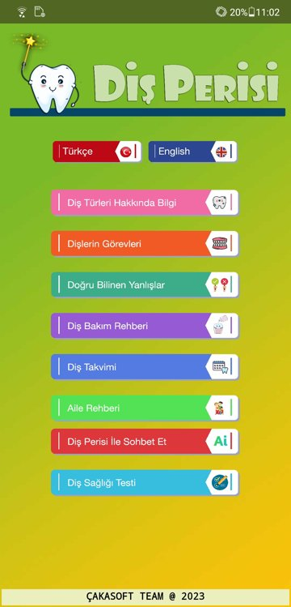
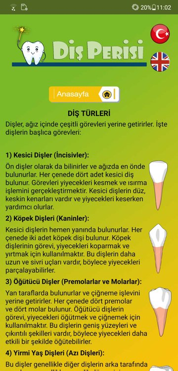
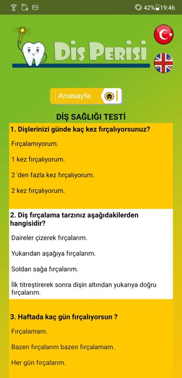
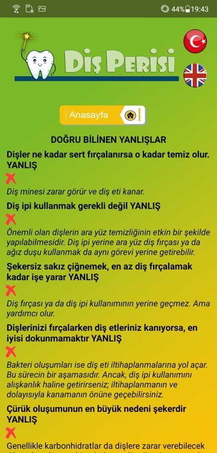
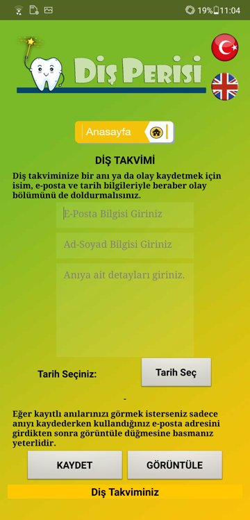

English | [Türkçe](README.tr.md)

# Tooth Fairy (Diş Perisi)

An AI-supported Android app for oral and dental health. It informs children, teenagers and parents through articles and videos, and helps them keep track of care and treatment. Built with MIT App Inventor 2, a Machine Learning for Kids model and Google Sheets for data.

**TEKNOFEST 2024 Technology for Humanity Competition** · Finalist, 10th place

Designed and built by two middle school students, with Oğuzhan Bilir as advisor.

## Screens

## How it works

- **Two languages:** every screen can switch between Turkish and English. The chosen language is passed between screens as the start value, so it stays the same as you move around.
- **Chat with the Tooth Fairy:** the user's message goes to a text model trained on Machine Learning for Kids. The app only answers when the model's confidence is above 80%, so off-topic questions don't get made-up answers.
- **Dental health quiz:** multiple-choice questions about brushing habits. The score resets each time the screen opens and the result is shown in the selected language.
- **Tooth calendar:** users can log a dental event (a lost tooth, an injury, a visit) with a date. Entries are saved to Google Sheets through a Google Form and can be listed again by email.
- **Guides:** tooth types and their jobs, a brushing and flossing guide with videos, a family guide, and a "common myths" screen.

## What's in this repo

This repo holds the release files, not the source code:

| File | Content |
|------|---------|
| `disPerisiv4.1.3.apk` | Installable Android build (v4.1.3) |
| `TÜBİTAK 2204B Proje raporu.pdf` | Project report (Turkish) |
| `EK 1 - …Türkçe Kullanım Kılavuzu.pdf` | User guide, Turkish |
| `EK 2 - …İngilizce Kullanım Kılavuzu.pdf` | User guide, English |
| `EK 3 - …ekran görüntüleri ve kodların detaylı açıklamaları.pdf` | Screenshots and a walkthrough of the code |

To try it, download the APK on an Android device and allow installs from unknown sources.
